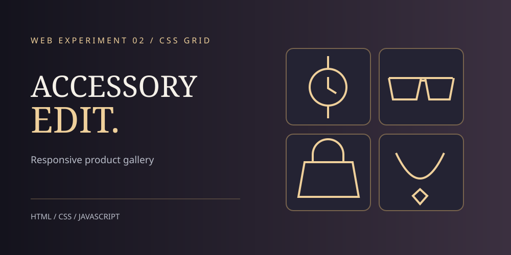

# Responsive Accessory Gallery



**Accessory Edit** is a responsive product-gallery experiment showcasing eight sample fashion accessories with their original local images and prices. The main learning objective is to combine CSS Grid for the catalogue layout with Flexbox for equal-height product cards.

**Status:** Academic project / implemented frontend prototype. No real commerce or verified public deployment.

## Features

- Eight original accessory products with local photographs
- Responsive grid that adapts to mobile, tablet and desktop widths
- Flexbox product-card layout and consistent image aspect ratios
- Search by name or description, category filtering and ascending/descending price sorting
- Reset controls, accessible labels, keyboard focus and result announcements
- Progressive enhancement: the full catalogue remains visible without JavaScript
- Reduced-motion support and no external dependencies

## Run locally

Open `index.html` in your browser, or from the repository root run:

```bash
python -m http.server 8000
```

Visit http://localhost:8000.

## Structure

- `index.html`: semantic catalogue and product content
- `styles.css`: responsive design, CSS Grid and Flexbox
- `gallery.js`: optional search, filtering and sorting
- `pic1.jpg`–`pic8.jpg`: existing product images
- `assets/cover.svg`: original project concept artwork
- `tests/gallery.test.js`: filtering and sorting regression tests

## Tests

With Node.js 18 or newer:

```bash
node --test tests/gallery.test.js
```

For manual browser testing, check narrow and wide viewports, keyboard navigation, filtering, sorting, reset, and the page with JavaScript disabled.

## Limitations

Product names, prices and descriptions are illustrative sample content, not verified retail offers. There is no cart, payment or backend. Image assets were retained from the original experiment; confirm usage rights before commercial reuse.

## Deployment

Host the repository root on a static web host. No live demo URL is listed until verified.
